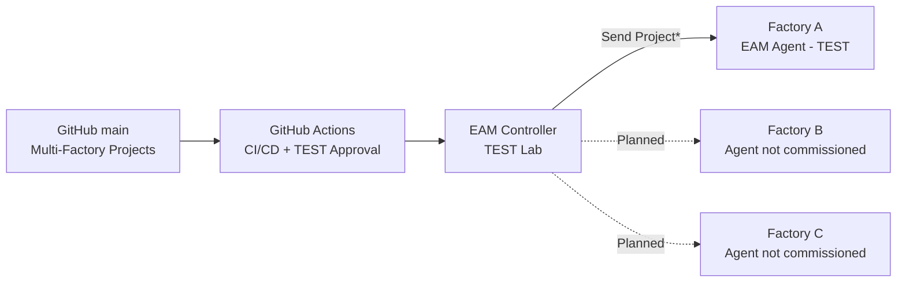
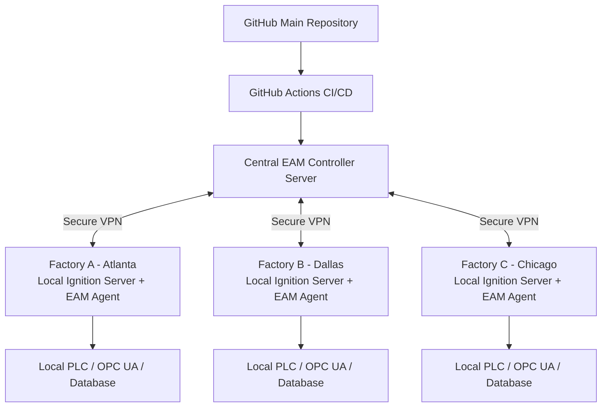
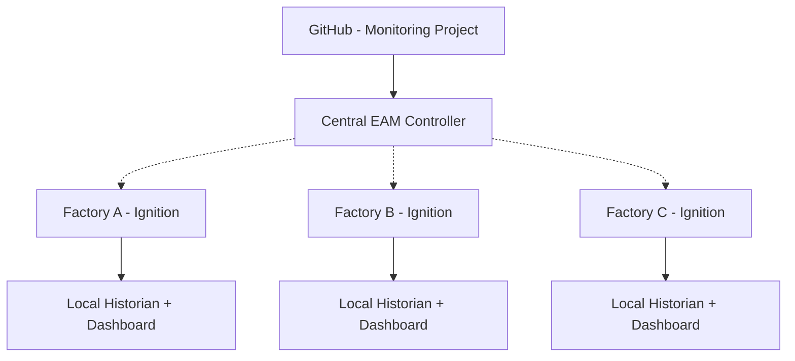

# Ignition CI/CD → EAM Controller → EAM Agent

**GitHub Actions CI/CD for native Ignition 8.3 projects across multiple factories.**
This repository demonstrates deployment to an **isolated TEST lab**, not to production.

## CI/CD deployment flow

**Key distinction:** GitHub Actions stages the project on the **EAM Controller**.
The Controller's existing **EAM Send Project** task transfers it to the
**EAM Agent** over Ignition Gateway Network. The Agent does **not** pull
source code from GitHub. **\*EAM Send Project runs only for a commissioned TEST task.**
**Dashed lines show a future architecture, not active deployment:** Factory B/C currently support validation only.

## Multi-location factory architecture (reference design)

**Reference architecture only:** Atlanta, Dallas, and Chicago are example locations,
not verified deployment sites. Each factory would keep its SCADA/PLC/database
operations local, with a VPN-protected Gateway Network connection to central EAM.
Factory B/C EAM Agents are **not commissioned** in this repository; current
deployment remains isolated TEST-only and production remains on HOLD.

## Multi-factory monitoring architecture (reference design)

**Reference design, not deployed monitoring infrastructure.** Each factory collects
Ignition device diagnostics and verified PLC metrics locally, stores historical
data in its own Historian, and displays a local Perspective dashboard.
The EAM Controller manages approved project delivery; it is **not** the central
PLC data collector. Dashed EAM links represent intended delivery paths,
not verified runtime connections. Factory B/C Agent deployments are not
commissioned; production deployment remains on HOLD.

## Reusable customer configuration (read-only demo)

To reuse the framework for your own factories, bring **real native Ignition
project resources** and update factory/Gateway/project manifests plus private
EAM Controller/Agent connection references. No Python code changes are needed
to produce a customer-specific **source validation/deployment plan**.

**[Customer setup + TEST Lab walkthrough](docs/CUSTOMER_SETUP.md)** ·
Example profile: [`config/example-customer-testlab.json`](config/example-customer-testlab.json) ·
Hosted workflow: [Customer Framework - Multi-Factory TEST Lab Demo](.github/workflows/customer-framework-demo.yml).

**Boundary:** the hosted demo validates and produces evidence without contacting
any Gateway. Real approved EAM transfer is still qualified only on this repo's
Factory A TEST Lab; arbitrary customer live deployment is **not yet supported**.

**Two supported customer configuration scenarios (one CI engine):**

- **One factory, many workshops:** `same_site` links using trusted routed LAN/VLANs.
- **Many factories, different locations:** `cross_site` links using private VPN/WAN/overlay.

Both support an on-prem or private-cloud EAM Controller. Real network
connectivity, EAM Agent trust, commissioning and runtime deployment remain
separate from the read-only source plan.

**Multi-site/workshop configuration:** A company can use on-prem and
private-cloud EAM Controllers, multiple remote locations, and multiple
workshops under one site in a single versioned profile.
See [portable customer topology](docs/CUSTOMER_TOPOLOGY.md) and
[the multi-site sample](config/example-company-multi-site.json).
Only read-only planning and optional TLS reachability have been implemented
for arbitrary customers; **generic EAM deployment is not yet verified**.

**Customer-specific CI:** Update [`config/customer.json`](config/customer.json)
with your company's sites, workshops, EAM Controllers and exact Agent targets;
then run [Customer CI - Validate Configured Sites](.github/workflows/customer-config-ci.yml).
This workflow reads the selected profile dynamically (no fixed demo site count).
It validates native project hashes and produces a read-only plan, **not** an
EAM deployment or proof of network/PLC connectivity.

## Run the TEST deployment

1. Commit your native Ignition project and factory manifest changes, open a PR, and pass CI.
2. Merge the reviewed changes into `main`.
3. In **GitHub → Actions**, open **Ignition EAM - Select Factory & Project (TEST)** (`.github/workflows/ignition-eam-multi-factory.yml`).
4. Choose a registered **Factory** and **Project**, then click **Run workflow** on `main`.
5. Validation resolves the approved Gateway. If eligible, approve the waiting `ignition-test` deployment.
6. The `ignition-lab` runner backs up the affected TEST project trees, stages the project on the EAM Controller, and verifies the scan.
7. For a separately commissioned project/task binding, the workflow checks the existing task and may invoke **EAM Send Project** once. Check uploaded evidence and independently verify the Agent and Perspective runtime.

## Current lab scope

| Target | Controller staging | EAM Send Project |
| --- | --- | --- |
| Factory A (`lab-warehouse`, `WarehouseHMI`) | Approved TEST path | Existing task configured as commissioned; execution requires runtime checks |
| Factory A (`FactoryASmoke`) | Approved TEST path | No registered Send Project task for this project |
| Factory B (`lab-assembly`) and Factory C (`lab-packaging`) | Validation only until commissioned | Not commissioned |

**A passing GitHub job, accepted EAM task, or matching Agent files is not a browser FAT pass.**
PLC/OPC UA mappings, alarm behavior, and production readiness require separate real-site verification.
**Production deployment is on HOLD.**

## Main workflows

- [Factory/Project TEST selection and Controller/EAM deployment](.github/workflows/ignition-eam-multi-factory.yml) — explicit manual dispatch, required approval.
- [Source validation](.github/workflows/validate.yml) — PR and reusable CI checks.
- [Native source release ZIP](.github/workflows/build-release.yml) — build only; no Gateway deployment.
- [Direct TEST Agent GitOps](.github/workflows/ignition-e2e.yml) — separate LAB-only path; **not** EAM Send Project.

## Configuration and detailed guides

- [Factory/Agent target registry](targets/lab-targets.json) — approved TEST targets and EAM task bindings.
- [Factory onboarding](docs/add-factory.md) · [Factory connections](docs/FACTORY_CONNECTIONS.md).
- [Reviewer approval](docs/APPROVAL_WORKFLOW.md) · [EAM task automation and guards](docs/AUTO_EAM_EXISTING_TASK.md).
- [Architecture](docs/architecture.md) · [Deployment guide](docs/deployment-guide.md).
- [Previous detailed README (archived)](docs/README_BEFORE_SIMPLIFICATION_2026-11-13.md) — historical reference; some status descriptions are outdated.

## Safety

Keep all credentials in GitHub Environment secrets, use a trusted isolated runner,
verify the exact factory/project/Agent identity, and back up before any change.
Never interpret a simulation PASS or EAM task receipt as production authorization.

**Maintainer:** [tomha85](https://github.com/tomha85) · **License:** [MIT](LICENSE).
