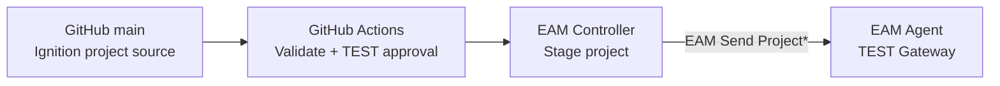

# Ignition CI/CD → EAM Controller → EAM Agent

**GitHub Actions CI/CD for native Ignition 8.3 projects across multiple factories.**
This repository demonstrates deployment to an **isolated TEST lab**, not to production.

## Architecture

**Key distinction:** The deployment workflow runs by manual dispatch. GitHub Actions stages the project on the **EAM Controller**.
The Controller's existing **EAM Send Project** task transfers it to the
**EAM Agent** over Ignition Gateway Network. The Agent does **not** pull
source code from GitHub. **\*EAM transfer runs only for a commissioned TEST task; otherwise staging stops at the Controller.**

## Run the TEST deployment

1. Commit your native Ignition project and factory manifest changes, open a PR, and pass CI.
2. Merge the reviewed changes into `main`.
3. In **GitHub → Actions**, open **Ignition EAM - Select Factory & Project (TEST)** (`.github/workflows/ignition-eam-multi-factory.yml`).
4. Choose a registered **Factory** and **Project**, then click **Run workflow** on `main`.
5. Validation resolves the approved Gateway. If eligible, approve the waiting `ignition-test` deployment.
6. The `ignition-lab` runner backs up the affected TEST project trees, stages the project on the EAM Controller, and verifies the scan.
7. For a separately commissioned project/task binding, the workflow checks the existing task and may invoke **EAM Send Project** once. Check uploaded evidence and independently verify the Agent and Perspective runtime.

## Current lab scope

| Target | Controller staging | EAM Send Project |
| --- | --- | --- |
| Factory A (`lab-warehouse`, `WarehouseHMI`) | Approved TEST path | Existing task configured as commissioned; execution requires runtime checks |
| Factory A (`FactoryASmoke`) | Approved TEST path | No registered Send Project task for this project |
| Factory B (`lab-assembly`) and Factory C (`lab-packaging`) | Validation only until commissioned | Not commissioned |

**A passing GitHub job, accepted EAM task, or matching Agent files is not a browser FAT pass.**
PLC/OPC UA mappings, alarm behavior, and production readiness require separate real-site verification.
**Production deployment is on HOLD.**

## Main workflows

- [Factory/Project TEST selection and Controller/EAM deployment](.github/workflows/ignition-eam-multi-factory.yml) — explicit manual dispatch, required approval.
- [Source validation](.github/workflows/validate.yml) — PR and reusable CI checks.
- [Native source release ZIP](.github/workflows/build-release.yml) — build only; no Gateway deployment.
- [Direct TEST Agent GitOps](.github/workflows/ignition-e2e.yml) — separate LAB-only path; **not** EAM Send Project.

## Configuration and detailed guides

- [Factory/Agent target registry](targets/lab-targets.json) — approved TEST targets and EAM task bindings.
- [Factory onboarding](docs/add-factory.md) · [Factory connections](docs/FACTORY_CONNECTIONS.md).
- [Reviewer approval](docs/APPROVAL_WORKFLOW.md) · [EAM task automation and guards](docs/AUTO_EAM_EXISTING_TASK.md).
- [Architecture](docs/architecture.md) · [Deployment guide](docs/deployment-guide.md).
- [Previous detailed README (archived)](docs/README_BEFORE_SIMPLIFICATION_2026-11-13.md) — historical reference; some status descriptions are outdated.

## Safety

Keep all credentials in GitHub Environment secrets, use a trusted isolated runner,
verify the exact factory/project/Agent identity, and back up before any change.
Never interpret a simulation PASS or EAM task receipt as production authorization.

**Maintainer:** [tomha85](https://github.com/tomha85) · **License:** [MIT](LICENSE).
